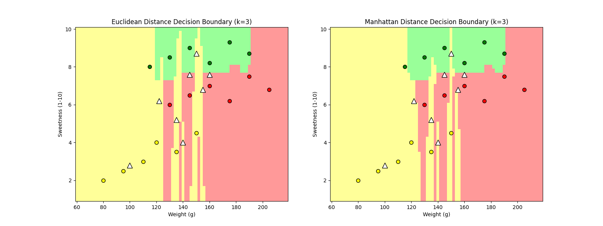

# The Geometry of AI Decisions

k-nearest neighbors built from scratch to show how the choice of distance metric reshapes a classifier's
decision boundaries: Euclidean vs. Manhattan on a small 2D fruit dataset (weight × sweetness), for k = 1, 3 and 5.



## What's in it

| Part | File | What it does |
|---|---|---|
| Classifier | `knn_engine.py` | Euclidean and Manhattan distance, majority vote, deterministic tie-breaking (lowest average neighbor distance, then a fixed class priority), optional min-max normalization. Standard library only |
| Dataset | `data_loader.py` | 18 labeled points plus 8 test points placed on class boundaries, where the two metrics are most likely to disagree |
| Evaluation | `evaluation.py` | Accuracy, per-class precision/recall/F1 and confusion matrices on a 450-point labeled holdout, a cross-check against scikit-learn's `KNeighborsClassifier`, and a timing test |
| Tests | `test_knn.py` | 10 unit tests: distances, invalid input, tie-breaking and normalization |
| Plots | `main.py` | Side-by-side decision boundary plots and a prediction comparison table |

## Findings

- **Feature scaling matters most.** Unscaled, weight (about 60–260 g) swamps sweetness (1–10) in the distance
  calculation, so at k=1 even the "normal banana" test point is labeled Lemon. Min-max scaling raises holdout
  accuracy from about 0.86–0.91 to 0.93–0.98.
- **It agrees with scikit-learn.** Predictions match on 100% of test points in nearly every configuration. The one
  exception (k=5, Euclidean, unscaled: 98.9%) comes from a different tie-breaking rule, not a distance bug.
- **It scales as expected.** Prediction time grows linearly with training size, from about 0.03 ms per query at
  18 points to about 7.4 ms at 3,000, which matches a brute-force O(n) search.

## Running it

```sh
cd Project/geometry_of_ai
python -m unittest test_knn.py      # 10 unit tests (no dependencies)
pip install numpy matplotlib scikit-learn
python main.py 3                    # prediction table + decision_boundaries_k3.png
python testing_harness.py           # every k × metric combination
python evaluation.py                # metrics, scaling, scikit-learn check, timing
```

The full methodology, complexity analysis and recorded output are in
[`Project/geometry_of_ai/README.md`](Project/geometry_of_ai/README.md) and
[`sample_input_output.md`](Project/geometry_of_ai/sample_input_output.md).

## Team

Group 3, algorithms design course:

- **Ranzel Virtucio**: dataset, boundary test points, tie-breaking rules
- **Luigi**: k-NN engine
- **Stephanie**: test harness and recorded results
- **Fiona**: decision boundary visualization
- **Melprin**: complexity analysis and report
